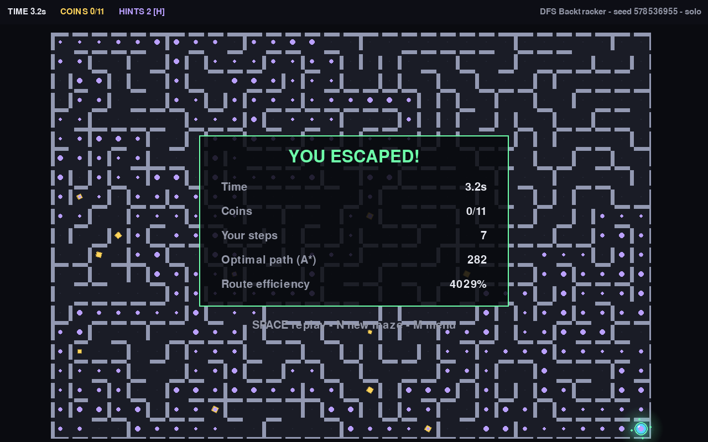
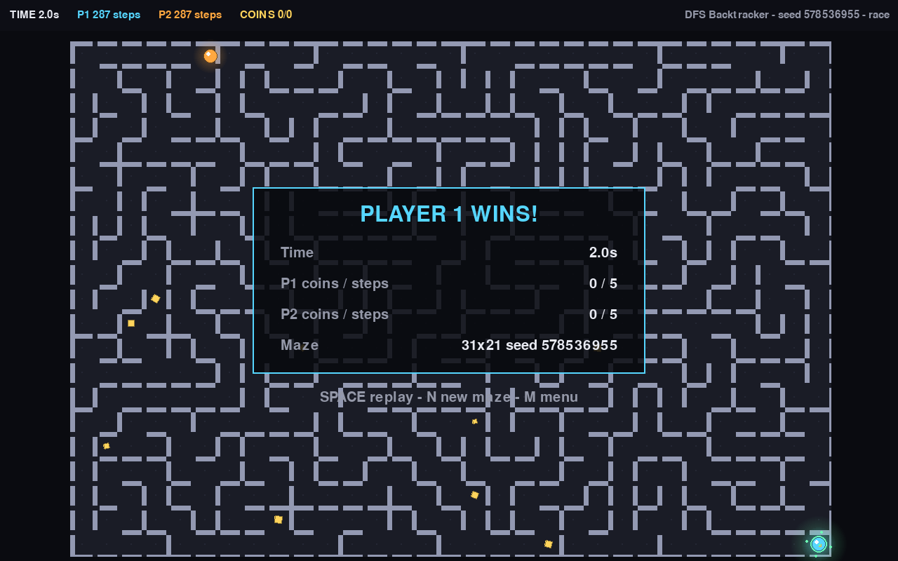
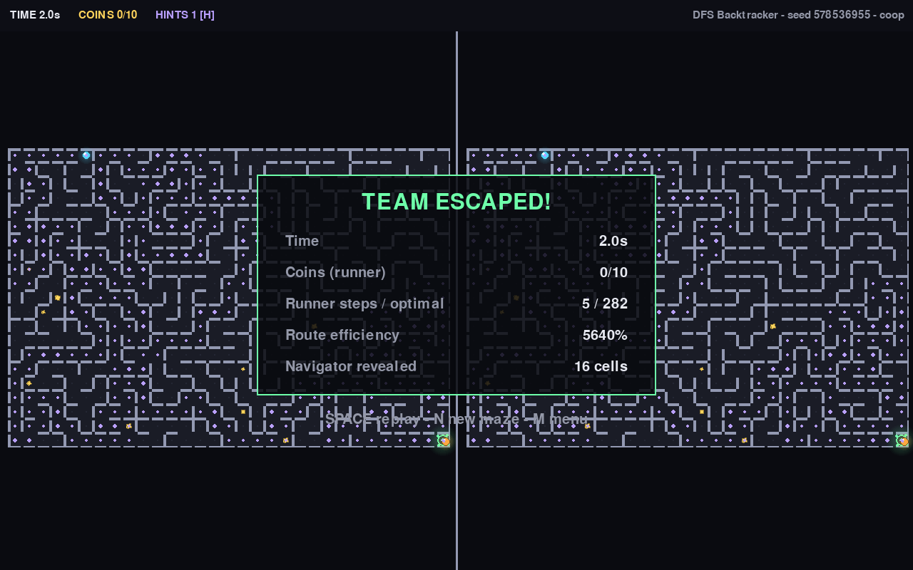
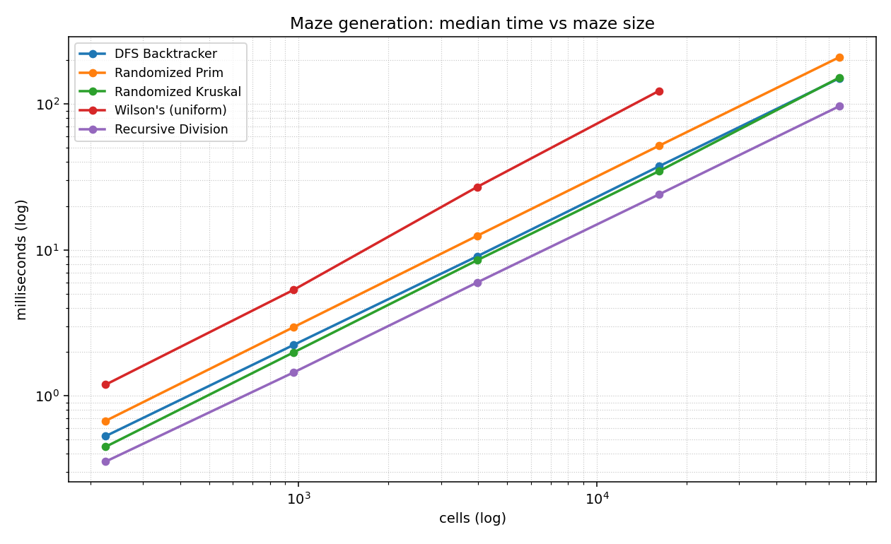
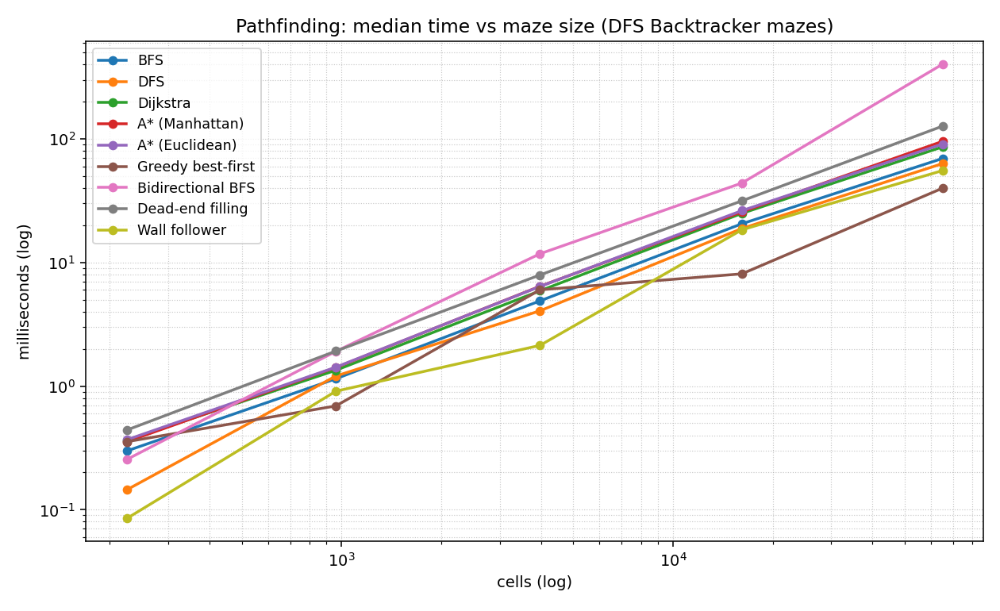
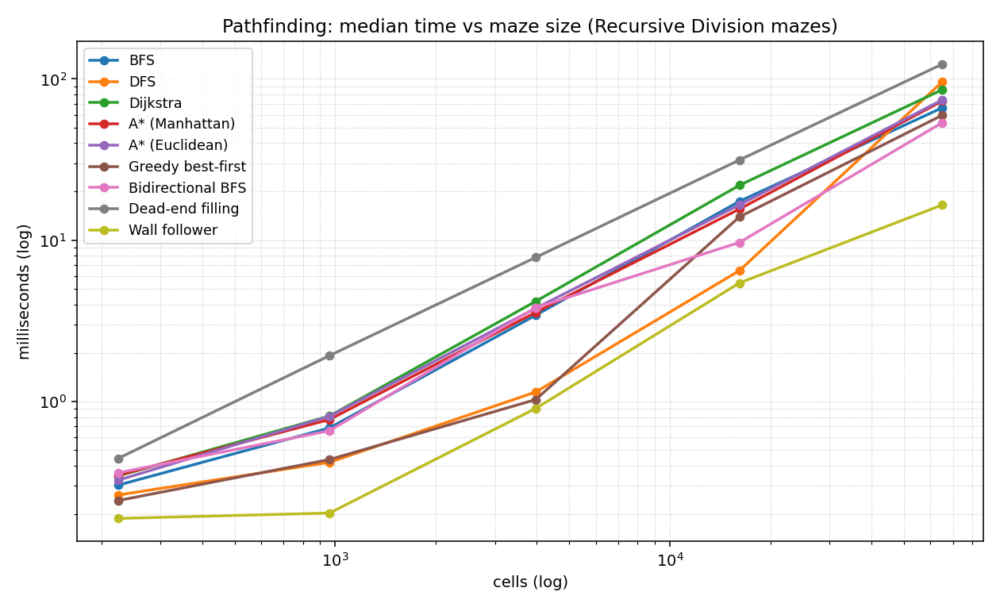
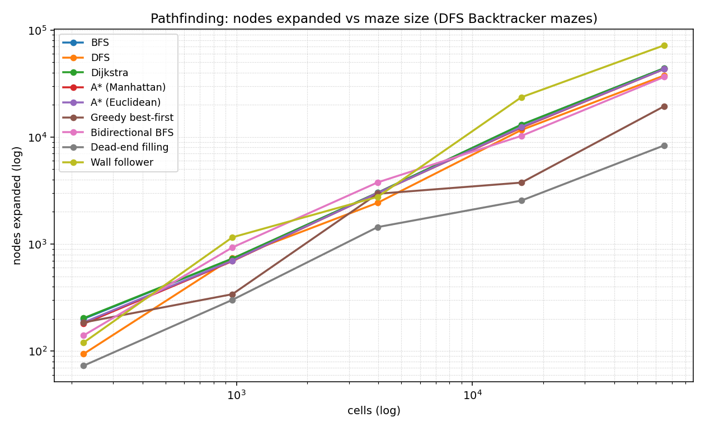
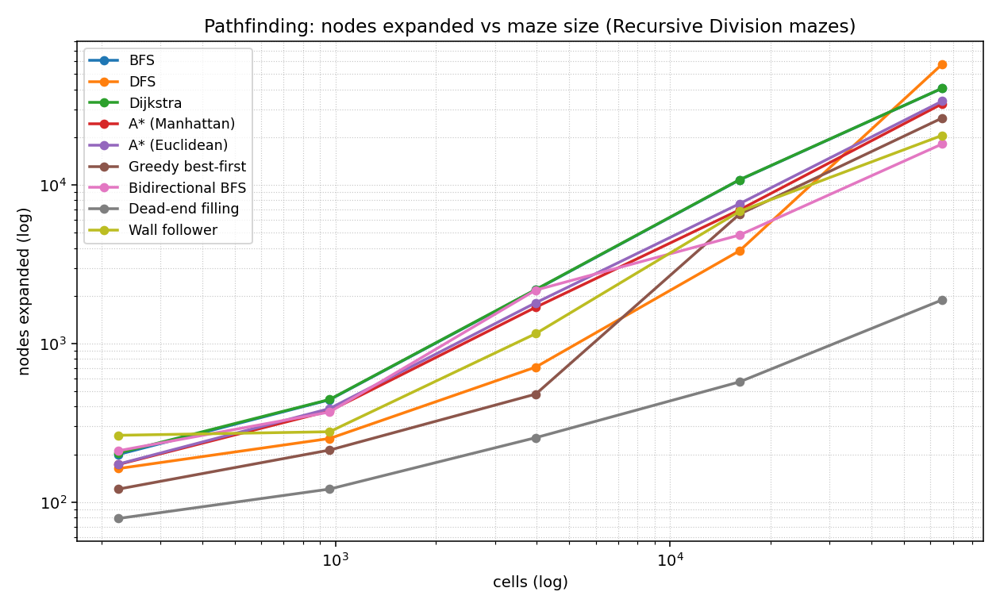
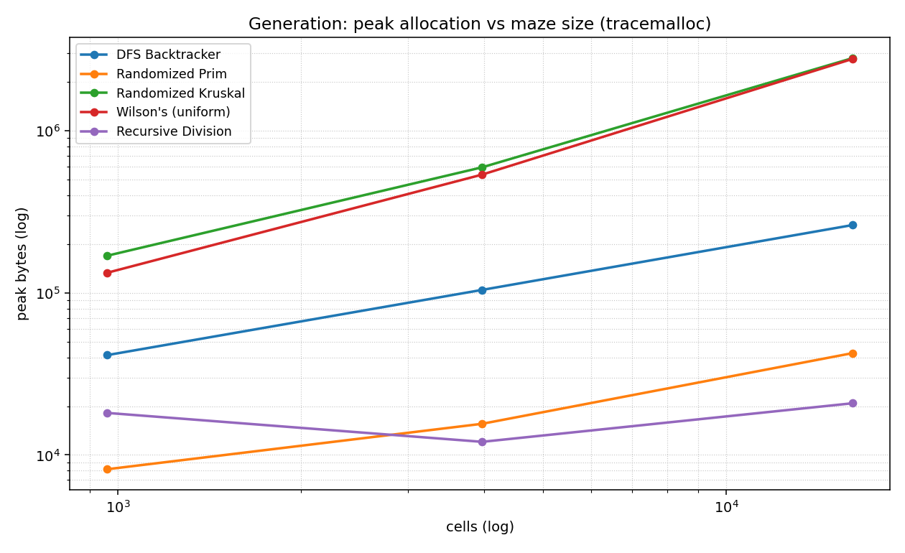

<<<<<<< HEAD
<<<<<<< HEAD
# Maze Runner

A procedurally generated maze game that doubles as a pathfinding playground:
**five maze-generation algorithms**, **eight pathfinding algorithms**, three
game modes (solo, 2-player race, 2-player split-screen co-op with asymmetric
fog of war), synthesized sound, and a benchmark suite that produces the
performance-analysis charts and CSVs.

Built with Python 3 + Pygame. The algorithm core (`maze/`) is pure Python with
zero GUI dependencies -- the game, the test suite, and the benchmarks all sit
on top of it.





## Quick start

### Windows

Open PowerShell or Command Prompt in the project folder:

```powershell
.\run.bat
```

To start directly in a mode:

```powershell
.\run.bat --mode coop --size large --gen wilson --seed 42
```

`run.bat` creates `.venv`, installs the dependencies, and launches the game.
Requires Python 3.9+ on PATH.

### macOS / Linux

```bash
cd maze-game
./run.sh                       # creates .venv, installs deps, runs the game

# or manually:
python3 -m venv .venv
.venv/bin/pip install -r requirements.txt
.venv/bin/python -m game.main
```

Jump straight into a specific configuration:

```bash
.venv/bin/python -m game.main --mode coop --size large --gen wilson --seed 42
```

Headless self-test (no window; used by CI):

```bash
SDL_VIDEODRIVER=dummy SDL_AUDIODRIVER=dummy .venv/bin/python -m game.main --smoke
```

Tests (42 of them -- maze perfection, solver optimality/validity, fog logic):

```bash
.venv/bin/python -m unittest discover -s tests
```

## The game

| Mode | Players | Twist |
|---|---|---|
| **Solo Run** | 1 | Fog of war with memory: see a lantern radius now, dimly remember where you've been. 3 A\* hints. |
| **Race (2P)** | 2, WASD + arrows | Both players sprint from the same corner to the exit. No fog -- fair fight. HUD shows live "steps to exit" for both, recomputed by A\* a few times per second. |
| **Co-op Split-Screen (2P)** | 2 | The showcase: P1 *Navigator* (left viewport) has a big lantern + memory; P2 *Runner* (right viewport) sees only a tiny circle, no memory. Only the runner can collect coins or finish. Talking is required. |

Every game replays the chosen generation algorithm **live** ("watch it build
the maze" -- SPACE skips), then a 3-2-1 countdown, then play. The results
screen compares your route to A\*'s optimal path and computes your **route
efficiency**.

### Controls

| Key | Action |
|---|---|
| WASD / arrows | move (P1 / P2) |
| `H` | A\* hint (solo: 3, co-op: 2; none in race) |
| `R` / `N` | restart same maze / new maze |
| `ESC` | pause (SPACE resume, `M` menu, `Q` quit) |
| `ENTER` | start (menu) |

Collectibles (`+100` each) are placed by a seeded RNG, far from the start.

## Algorithms

### Maze generation (all produce *perfect* mazes: spanning trees)

| Algorithm | Idea | Texture | Complexity |
|---|---|---|---|
| DFS Backtracker | Random-depth carve + backtrack (iterative stack) | long winding corridors | O(n) time / O(n) stack |
| Randomized Prim | Grow from a random frontier cell | bushy, many dead ends | O(n log n)-ish |
| Randomized Kruskal | Shuffle all walls; carve when union-find says "two trees" | even, unbiased-ish | O(n α(n)) + shuffle |
| Wilson's | Loop-erased random walks; samples spanning trees **uniformly** | no structural bias at all | O(n) expected, big constant |
| Recursive Division | Start open; add walls with one gap, recursively | long straight halls, rooms | O(n log n) |

The same seed always reproduces the same maze (shown in the HUD; fixable via
`--seed`).

### Pathfinding

| Algorithm | Optimal? | Notes |
|---|---|---|
| BFS | yes | baseline; goal test at discovery |
| DFS | on perfect mazes (see findings) | returns *a* path, wanders first |
| Dijkstra | yes | = BFS + priority queue on unit-cost grids |
| A\* (Manhattan / Euclidean) | yes | admissible heuristics; ties prefer low g |
| Greedy best-first | no (on perfect mazes: yes) | fastest, expands fewest nodes |
| Bidirectional BFS | yes | alternating full layers; meet-in-the-middle |
| Dead-end filling | yes (perfect mazes) | prunes dead ends, then reads off the corridor |
| Wall follower | walks, not plans | right/left hand on wall; no map needed |

The game uses A\* for hints and the live race HUD, and BFS for the menu's
attract-mode dot.

## Performance analysis

Run everything (a few minutes) and regenerate charts + CSVs:

```bash
.venv/bin/python benchmarks/run_all.py           # full sweep
.venv/bin/python benchmarks/run_all.py --quick   # smaller sweep
```

Outputs land in `benchmarks/results/`: `generation.csv`,
`pathfinding_dfs.csv`, `pathfinding_division.csv`, `memory.csv`, and the
charts below. Numbers below are from Python 3.9 on an Apple M-series laptop;
your machine will differ, the *shape* won't.

### 1. Maze generation -- time vs size (median of 5)

| cells | Division | Kruskal | DFS | Prim | Wilson |
|---:|---:|---:|---:|---:|---:|
| 225 | 0.35 ms | 0.45 ms | 0.53 ms | 0.67 ms | 1.19 ms |
| 961 | 1.45 ms | 1.98 ms | 2.23 ms | 2.96 ms | 5.32 ms |
| 3,969 | 5.99 ms | 8.50 ms | 9.05 ms | 12.50 ms | 27.04 ms |
| 16,129 | 24.00 ms | 34.64 ms | 37.38 ms | 51.71 ms | 122.94 ms |
| 65,025 | 96.75 ms | 151.84 ms | 150.35 ms | 209.57 ms | -- (see note) |



* All algorithms scale linearly in cells (log-log slope ≈ 1.9, reflecting the
  extra ~O(√n) per-cell neighbor work as mazes grow).
* **Recursive Division is the cheapest** -- it adds ~n walls but does no
  per-cell candidate scanning.
* **Wilson's costs ~3-4x DFS** at equal size: its early random walks wander
  long before hitting the visited set. That is the price of *uniform*
  spanning-tree sampling. (Benchmarked up to 127x127; random walks at 255²
  take minutes in pure Python.)

### 2. Pathfinding -- texture matters more than algorithm

Corner-to-corner searches, median of 5, **snake-like DFS maze @ 255x255 (optimal = 8,358 steps)**:

| Solver | Time | Nodes expanded | Path |
|---|---:|---:|---|
| Greedy best-first | **39.9 ms** | 19,407 | 8,358 |
| Wall follower | 55.4 ms | 72,046 steps | 72,046 (longer) |
| BFS | 69.4 ms | 44,003 | 8,358 |
| Dijkstra | 86.1 ms | 44,013 | 8,358 |
| A\* (Manhattan) | 95.4 ms | 43,166 | 8,358 |
| Dead-end filling | 126.7 ms | 8,359 | 8,358 |
| Bidirectional BFS | 401.8 ms | 36,465 | 8,358 |

**Roomy Recursive-Division maze @ 255x255 (optimal = 1,882 steps):**

| Solver | Time | Nodes expanded | Path |
|---|---:|---:|---|
| Greedy best-first | **59.5 ms** | 26,363 | 1,882 |
| Wall follower | 16.5 ms | 20,498 steps | 20,498 (longer) |
| Bidirectional BFS | 53.5 ms | **18,092** | 1,882 |
| BFS | 66.2 ms | 40,574 | 1,882 |
| A\* (Manhattan) | 72.9 ms | 32,415 | 1,882 |
| Dijkstra | 85.7 ms | 40,622 | 1,882 |
| Dead-end filling | 123.4 ms | 1,883 | 1,882 |






**Findings worth reporting:**

1. **Perfect mazes have exactly one simple path between any two cells.**
   Every solver that returns a simple path (even DFS, even greedy
   best-first) therefore returns *the* optimal path -- differences show up
   only in time and nodes expanded. (The test suite pins this down; greedy's
   suboptimality is instead demonstrated on looped mazes.)
2. **Texture decides who wins.** On a snake corridor maze, everything is "on
   the way", so informed search cannot skip much -- greedy wins simply by
   never re-queuing, and bidirectional BFS *loses badly* (401 ms): its two
   half-depth balls cover nearly the same corridor and cells get popped by
   both sides. On roomy division mazes with many alternative routes, A\*
   skips 20% of BFS's expansions and bidirectional BFS **halves** BFS's
   expansions and wins outright.
3. **Dead-end filling "expands" almost nothing** (only the final corridor is
   BFS-read-off) but pays for it in the pruning pass -- its node count is
   flattering, its wall clock is not.
4. **The wall follower walks the boundary.** In a simply-connected maze the
   right-hand rule traverses each edge at most twice; from a corner it
   circumnavigates the whole outer wall (72,046 steps for an 8,358-step
   optimal route) -- yet it needs no map, only local walls.

### 3. Memory (tracemalloc peak)

Generation @ 127x127 (16,129 cells): Division 20.8 KB, Prim 42.5 KB, DFS
262 KB, Wilson 2.78 MB, Kruskal 2.81 MB (the edge list dominates; it holds
all 2n candidate walls before shuffling).

Solvers @ 127x127: dead-end filling 271 KB, greedy 404 KB, bidirectional
1.68 MB, BFS 1.38 MB, DFS 1.91 MB, A\*/Dijkstra 2.79 MB (dict-of-parents +
heap), wall follower 1.40 MB -- which is almost entirely its own walked path
(23,556 cells).



## Project structure

```
maze-game/
├── maze/                  # pure algorithms (no pygame)
│   ├── grid.py            #   wall-bitmask grid data structure
│   ├── generators.py      #   DFS / Prim / Kruskal / Wilson / Division
│   ├── pathfinding.py     #   BFS / DFS / Dijkstra / A* / greedy / bidirectional /
│   │                      #   wall follower / dead-end filling
│   └── rng.py             #   seeded RNG helpers
├── game/
│   ├── main.py            # entry point + state machine + menu
│   ├── game_modes.py      # solo / race / co-op rules
│   ├── player.py          # grid movement, smooth interpolation
│   ├── visibility.py      # line-of-sight fog (Amanatides-Woo raycast)
│   ├── renderer.py        # maze surfaces, camera, entities, fog layer
│   ├── effects.py         # particles, screen shake, generation animation
│   ├── audio.py           # synthesized sfx + music (fails soft)
│   └── config.py          # tuning, palette, menu options
├── benchmarks/            # bench_generation / bench_pathfinding / bench_memory
│   │                      # + plots.py + run_all.py  -> results/*.csv, *.png
├── tests/                 # 42 unittest cases (perfection, optimality, LOS)
├── tools/generate_sounds.py  # stdlib .wav synthesizer (auto-run on first launch)
├── assets/                # sounds/ (generated) + screenshots/
├── requirements.txt       # pygame (+ matplotlib for charts)
└── run.sh                 # bootstrap + launch
```

## Troubleshooting

* **No sound** -- assets/sounds is generated on first launch by
  `tools/generate_sounds.py` (pure stdlib). If it was interrupted, run it
  manually. The game itself runs fine (silently) without mixer or files.
* **`matplotlib` missing** -- only needed for `benchmarks/plots.py`; install
  with `pip install matplotlib` or drop it.
* **Small window** -- the game targets 1280x800; all menu sizes fit at >=10px
  tiles. Custom mazes larger than the window follow the player(s) with a
  clamped camera.
=======
# Fintrack
>>>>>>> bd6ab8bdb618fc08233d50ddb0a634697babe7c9
=======
# Maze-Game
>>>>>>> bc5987b60065ec61863d649a14f1ccb71efc5417
